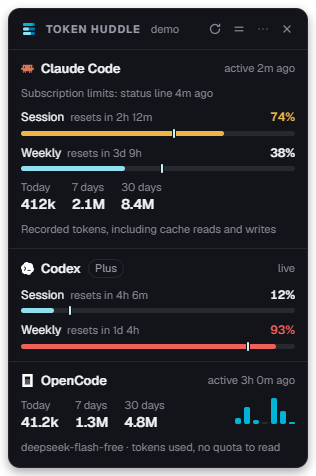
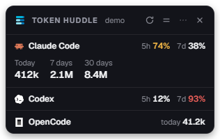

# Token Huddle

A small always-on-top desktop widget that shows where you stand on your coding-agent usage limits: Claude Code, Codex and OpenCode in one place, so you don't have to open each tool to check.



Compact view:



## It never touches your logins

Token Huddle does not read, store or use any tool's login token, and it makes no network calls of its own, except checking this project's GitHub Releases for a newer version, which **Automatically check for updates** turns off. That check sends no personal data. Otherwise it only reads what each tool hands over or writes to disk. That keeps it inside the vendors' terms, which reserve subscription logins for their own apps.

| Agent | What you see | Where it comes from |
| --- | --- | --- |
| Claude Code | Recorded tokens today, over 7 days and over 30 days; optional 5-hour and weekly limits | Local session files supply token totals automatically. Optionally enable subscription limits in Settings; Claude Code's status line then hands quota readings to a small local script. |
| Codex | 5-hour session and weekly limits, with reset times | The installed `codex` program is asked for your limits (Codex makes that call itself). If it cannot answer, the snapshot Codex writes to its session logs after each turn is used. |
| OpenCode | Tokens used today, in the last 7 days and the last 30 days | OpenCode's local database. OpenCode sits on top of many model providers, so it has no single quota to report. |

Each bar turns amber at 70% and red at 90%. The small tick on a bar marks how much of the window's time has passed: if the fill is past the tick, you are using your limit faster than the window is running out.

Every card says where its numbers came from: `live` (asked just now) or how long ago the tool last reported.

## Install

[Download for Windows](https://github.com/arkaslittlemind/token-huddle/releases/latest/download/Token-Huddle-Setup.exe), or choose the portable build from the [latest release](https://github.com/arkaslittlemind/token-huddle/releases/latest).

Two Windows builds, made with `npm run dist` (in `dist/`):

- **`Token-Huddle-Setup-<version>.exe`** installs Token Huddle for your Windows user, with a Start menu entry and an uninstaller.
- **`Token-Huddle-<version>-portable.exe`** runs without installing.

The builds are not code-signed ([why](docs/code-signing.md)). The first time you run one, Windows SmartScreen may show "Windows protected your PC". Select **More info**, check that the file came from this project's GitHub Releases, then select **Run anyway**. To check a download first, see the checksum step under [Releasing](#releasing). Both keep their settings in `%APPDATA%\Token Huddle`, the same folder `npm start` uses.

### Updates

The installed and portable app check this project's GitHub Releases 30 seconds after they start and then every 6 hours. When a newer version exists, the tray menu and Settings say so. In the installed app, **Install update** downloads it and restarts into the new version; nothing is downloaded or installed before you click. The portable app cannot replace itself, so **Download** opens the release page instead. Click **Check for updates** in Settings to check immediately; the result shows whether Token Huddle is up to date or offers an update to install. Turn **Automatically check for updates** off in the tray menu or Settings to stop background checks. You can still check explicitly with the button without turning background checks back on.

### Uninstall

Uninstall Token Huddle from Windows Settings > Apps. The uninstaller removes the `statusLine` entry that **Connect** added to Claude Code's `settings.json`, the same way **Disconnect** does, and turns off "Start with Windows". Installing a newer version over an older one does not disconnect anything.

- The portable build has no uninstaller: click **Disconnect** in Settings before you delete it.
- If you linked your own status line, Token Huddle does not edit it on uninstall either. Delete the prefix from your command yourself.
- Token Huddle's own folder, `%APPDATA%\Token Huddle`, stays, because a linked status line still calls the script in it. Delete it by hand once nothing uses it.

## Run it from source

Requires [Node.js](https://nodejs.org) 22 or newer.

```sh
npm install
npm start
```

`npm run demo` starts it with sample data.

Drag the widget by its title bar; it remembers where you put it, and snaps to a screen edge when you let go close to one. Clicking the tray icon brings it forward on the first click and keeps it open. It stays above other apps when focus changes. Use the close button, **Hide widget** menu action, or **Ctrl+Alt+H** to hide it; the shortcut also reopens it. If a monitor goes away or the display scaling changes, the widget moves back into view on its own. A right-click on the tray icon (or the `···` button) opens the options: settings, compact view, theme (system, light or dark), style (solid or translucent), size (100, 115 or 130%), local files only, start with Windows.

## Settings

On start, Token Huddle looks for each supported tool and adds a card for every one it finds. A tool you install later appears on the next refresh. The very first time, the settings window opens with a short welcome: what was found, where each card's numbers come from, **Connect…** for Claude Code, and what Token Huddle never touches. **Done** (or closing the window) ends it for good. In **Settings…** you can:

- show, hide and reorder cards;
- connect or disconnect Claude Code;
- set the alert levels and switch alerts on or off for each card (see below);
- add another account of a tool that keeps its data in a separate folder (for example a work login). The folder is checked before it is saved.

### Alerts

Token Huddle shows a Windows notification when a card's session or weekly usage passes a level you set in **Settings…** (80% and 95% by default). Each level alerts once per limit until it resets, also across restarts. Every card has its own **Alerts** switch. Selecting a notification shows the widget. Demo mode never alerts.

### Connecting Claude Code

Claude Code token totals appear automatically from local session records. Totals include input, output, cache creation and cache read tokens; they are recorded activity, not subscription consumption. Coverage depends on each interface writing compatible local session records; terminal, VS Code and T3 Code coverage is still being verified. Local files are checked every minute, and Refresh checks them again. Token Huddle keeps only derived metadata in memory, without saving conversation content.

Subscription percentages require the optional bridge. **Connect…** shows the exact change first, then adds one `statusLine` entry to Claude Code's `settings.json` and keeps a backup copy of the file. **Disconnect** removes the entry again.

After each response, Claude Code runs the script. It saves your session and weekly percentages and their reset times, nothing else, and prints a short line such as `5h 24% | 7d 41%` that Claude Code shows at the bottom of the terminal.

Limits of this source:

- It updates only from Claude Code in a terminal. Claude Code in the VS Code extension and in T3 Code does not run the status line (checked in November 2026; the terminal ran Claude Code 2.1.325), so usage from those, and from other Claude apps, shows up at your next Claude Code response in a terminal.
- It carries the session and weekly limits only, not per-model limits.
- If you already have your own status line, Token Huddle will not replace it. See below to use both.
- Windows only for now.

### If you already have your own status line

Token Huddle never edits your own status line. Instead, Settings shows **Copy prefix** on the Claude Code card. Put the copied text at the very start of the `"command"` value under `"statusLine"` in Claude Code's `settings.json`, inside its quotes, and save. It is already escaped for JSON.

The prefix saves your session and weekly usage for the widget, then hands Claude Code's input on, unchanged, to your own command. Your status line looks the same as before. If saving fails, your command still gets its input. The card then shows **Linked**, and the usage arrives after your next Claude Code response in a terminal. Each response takes a little longer, because PowerShell starts first.

To unlink, delete the prefix from the command again.

## Caveats

- Built and tested on Windows 11.
- Codex's "read rate limits" request is marked experimental by Codex and may change. The session-log fallback keeps the card working if it does.
- A live Codex reading is refreshed every 5 minutes; local sources every minute. The refresh button forces an update.
- "Local files only" stops Token Huddle from starting the `codex` program; Codex then shows the reading from its last turn.

## Project layout

```text
src/main/main.js             windows, tray, settings, refresh loop
src/main/instances.js        the user's list of cards; validates every reading
src/main/providers/index.js  the provider registry and the provider contract
src/main/providers/*.js      one file per agent
src/main/alerts.js           threshold notifications, once per limit until it resets
src/main/updates.js          the update check against this project's GitHub Releases
src/main/appearance.js       theme, style and size
src/main/placement.js        window position, edge snapping and off-screen recovery
src/main/cleanup.js          what the uninstaller undoes (disconnect every card)
src/renderer/                the widget and the settings window (plain HTML, CSS and JS)
scripts/launch.js            starts Electron with a clean environment
scripts/screenshot.js        captures the widget to a PNG
scripts/make-icon.js         writes build/icon.ico from the drawn mark (npm run dist)
scripts/release-notes.js     takes a release's notes from CHANGELOG.md
build/installer.nsh          the uninstaller's disconnect step
scripts/capture-statusline.ps1  records Claude Code's status line input to refresh a test fixture
test/                        tests and sample vendor data
docs/                        screenshots, brand, code signing, beta guide, launch playbook, site deployment
.github/workflows/           Verify (pull requests and main) and the tagged release build
site/                        the landing page (Astro + TypeScript); reads the brand from src/renderer at build time
```

## Adding a provider

1. Add a file in `src/main/providers/` that exports `id`, `name`, `accent`, `about` (one sentence on where its numbers come from, shown in the first-run welcome), `connect`, `detect()` and `read()`. The contract is described at the top of [providers/index.js](src/main/providers/index.js).
2. Add it to the list in `providers/index.js`.
3. Add a sample of the vendor's data to `test/fixtures/` and a test that reads it.

Two rules for every provider:

- **No logins.** Do not read a tool's token or credential file, and do not call a vendor's service with it. Use data the tool itself writes or hands over.
- **No shared state.** Keep per-account state in the `cache` object passed to `read()`, not in module variables, so two accounts of the same provider do not share it.

## Tests

```sh
npm test
```

The tests use Node's built-in runner and need no network. [test/fixtures/README.md](test/fixtures/README.md) says where each sample came from.

Before sending a change, run the full check:

```sh
npm run verify
```

It runs ESLint, the Prettier format check (`npm run format` fixes formatting), the tests (and fails if no test ran), then the landing page's own checks, tests and build. The landing page is a separate npm project that needs Node.js 22.23.4 or newer; install it once with `npm ci --prefix site`. GitHub Actions runs the same command on Windows for every pull request and every push to `main` ([.github/workflows/verify.yml](.github/workflows/verify.yml)).

## Landing page deployment

The static site in `site/` is deployed on Cloudflare Pages at
`tokenhuddle.arkaslittlemind.com`, with the custom domain active. See [deployment settings, DNS setup and rollback](docs/site-deployment.md);
its deployment record holds the live evidence and the acceptance checks.

To work on the page locally, run `npm run site:dev` (dev server) or `npm run site:build` (static build in `site/dist/`).

## Releasing

Releases are built by GitHub Actions from a version tag ([.github/workflows/release.yml](.github/workflows/release.yml)), never from a local machine:

1. Set `version` in `package.json` (`0.x` until the public launch is stable).
2. In `CHANGELOG.md`, rename `[Unreleased]` to `[X.Y.Z] - YYYY-MM-DD`, add a fresh empty `[Unreleased]` above it, and update the link references at the bottom. For the first release, also delete the line that starts with "Nothing has been released yet", or it opens the release notes.
3. Commit, then push a tag `vX.Y.Z` that matches the version.
4. The workflow runs the Verify checks, takes the release notes from that `CHANGELOG.md` section (it stops if the tag and version differ or the section is missing), builds the installer and the portable `.exe`, and attaches them to a **draft** GitHub Release with `SHA256SUMS.txt` and the files the in-app updater reads.
5. Review the draft on GitHub and publish it.

Check a download with `Get-FileHash <file> -Algorithm SHA256` against `SHA256SUMS.txt`. A tag with a suffix (`v0.1.0-rc.1`) makes a pre-release that takes its notes from `[Unreleased]`; use it only to test the pipeline. `npm run dist` builds the same two files locally and never uploads anything.

The release workflow also attaches `Token-Huddle-Setup.exe`, a copy of the versioned installer included in the checksums. The landing page uses `/releases/latest/download/Token-Huddle-Setup.exe` so clicking Download starts the installer download even without JavaScript or a successful GitHub API lookup. This requires a public, published stable release.

## Disclaimer

Token Huddle is an independent, unofficial project. It is not affiliated with, endorsed by, or sponsored by Anthropic, OpenAI, or the OpenCode project. Claude and Claude Code are trademarks of Anthropic; Codex and ChatGPT are trademarks of OpenAI. The names and the official marks of Claude Code, Codex and OpenCode are used, unaltered, only to say which tools the widget reads from; the marks belong to their owners.

You are responsible for making sure your use fits the terms of the services you subscribe to. The software is provided as is, with no warranty; see the license.

## Security

See [SECURITY.md](SECURITY.md) for how to report a vulnerability and what the app does and does not touch.

## License

[MIT](LICENSE) © 2026 Arkadipta Mojumder
