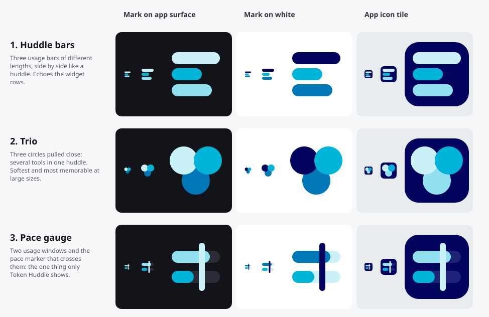

# Logo concepts

The logo stays open until the landing page (build-plan step 21). The app uses
a provisional mark until then.

The maintainer's own marks (Columns, Usage rows, Tracks & fills) are compared
in context in [`prototypes/logo-marks.html`](../../../prototypes/logo-marks.html):
widget header, Windows tray, app icon and landing page header. Their working
files stay local and are not tracked.

The three early concepts below were drawn first and remain options.

Every mark is drawn on a 32-unit grid from rounded rectangles and circles only,
so the tray icon can draw it pixel by pixel in code. Colours are Ocean Breeze:
navy `#03045E`, blue `#0077B6`, cyan `#00B4D8`, sky `#90E0EF`, mist `#CAF0F8`.

| # | Concept | Idea | Strength | Cost |
| --- | --- | --- | --- | --- |
| 1 | Huddle bars | Three usage bars of different lengths | Matches the widget rows; crisp at 16 px | Reads as a generic "list" or menu icon |
| 2 | Trio | Three circles pulled close together | The most memorable shape; says "several tools together" | Says nothing about usage or limits; circles soften at 16 px |
| 3 | Pace gauge | Two usage bars crossed by the pace marker | Shows the one thing only Token Huddle has: the pace marker | Busiest at 16 px; the marker reads as a "+" from a distance |

Files per concept: `<id>-dark.svg` (on the app's dark surface), `<id>-light.svg`
(on white) and `<id>-icon.svg` (on the navy app-icon tile).
